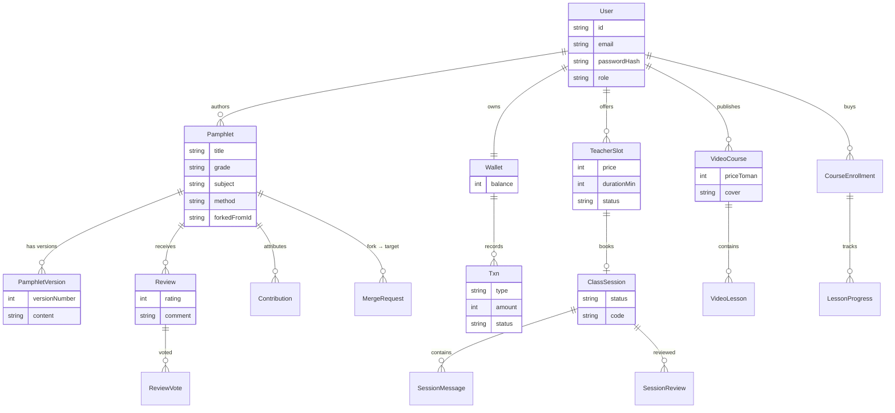

# OpenEdu Git — معماری فعلی (Architecture as Implemented)

> این سند **واقعیت کد** را توصیف می‌کند (تاریخ به‌روزرسانی: 2026-10-30).
> پشتهٔ چشم‌انداز اولیه (FastAPI/PostgreSQL/MinIO/Redis/K8s) در [docs/archive/2026-10-pre-reconciliation/ARCHITECTURE.md](archive/2026-10-pre-reconciliation/ARCHITECTURE.md) آرشیو شده؛ انحراف‌ها و مسیر بازگشت به آن اهداف در [docs/adr/](adr/) مستند است.

## 1. نمای کلی سیستم

```
مرورگر (RTL SPA، hash routing)
   │
   ├─ HTTP ────────────► Next.js 16 (App Router، پورت 3000)
   │                       ├─ src/app/page.tsx  → شِل SPA + دیسپچ روت‌های #
   │                       └─ src/app/api/v1/* → REST API (سرور همان اپ)
   │                              └─ Prisma Client → SQLite (db/custom.db)
   │
   └─ WebSocket ──► Caddy گیت‌وی (پورت 81، اختیاری) ─► classroom-service
                     با ?XTransformPort=3003            (socket.io، پورت 3003)
                                                            └─ HMAC room ticket
```

- **یک اپ Next.js** هم فرانت‌اند را می‌سازد و هم API را (monolith متعمد).
- **یک مینی‌سرویس مستقل** برای بلادرنگ: `mini-services/classroom-service` (socket.io 4.8، بدون وابستگی به `src/`).
- **Caddy (اختیاری):** گیت‌وی پورت 81 با ترفند `?XTransformPort=<port>` برای عبور WebSocket از پروکسی.

## 2. جدول پشته

| لایه | فناوری | نسخه | یادداشت |
|---|---|---|---|
| فریم‌ورک | Next.js (App Router) | 16 | Turbopack در dev؛ `output: "standalone"` |
| UI | React + TypeScript | 19 / 5.x | SPA تک‌روت با hash routing (`#/pamphlet/{id}`) |
| استایل | Tailwind CSS | 4 | برند: #DD614C، گوشه‌های تیز، RTL-first؛ توکن‌ها در `globals.css` |
| ORM | Prisma | 6 | `db push` استفاده می‌شود، Migrate هنوز نه (ADR-0003) |
| دیتابیس | SQLite | — | فایل `db/custom.db`؛ PostgreSQL برای پروداکشن برنامه‌ریزی شده (ADR-0002) |
| احراز هویت | scrypt + HMAC-SHA256 | node:crypto | توکن امضاشده در کوکی httpOnly `oeg_session`، ۷ روز (ADR-0004) |
| بلادرنگ | socket.io | 4.8 | چت + تختهٔ مشارکتی + presence؛ بلیت HMAC ۶ ساعته |
| کامپوننت | shadcn/ui (Radix) | — | با آستک برند سفارشی |
| ران‌تایم | bun / node | ≥1.3 / ≥20 | `bun run dev`، `bun prisma/seed.ts` |

## 3. نقشهٔ پوشه‌ها

```
src/
├── app/
│   ├── api/v1/            # REST API — auth, pamphlets, reviews, merge-requests,
│   │                      # wallet, market, teachers, slots, sessions, courses,
│   │                      # lessons, learn, users, stats
│   ├── layout.tsx         # RTL، فونت وزیرمتن
│   ├── page.tsx           # شِل SPA + دیسپچ روت‌های hash
│   └── globals.css        # توکن‌های برند (Tailwind v4)
├── components/edu/        # ویوها (home, pamphlet-view, market, classroom, …)
│   ├── router.ts          # useHashRoute
│   ├── store.ts           # Zustand (نشست/احراز هویت)
│   └── hooks.ts           # useFetch، useDebounced
└── lib/
    ├── client.ts          # api<T>() — کلاینت متمرکز fetch
    ├── constants.ts       # GRADES, SUBJECTS, METHODS, … (تاکسونومی فارسی)
    ├── types.ts, format.ts, diff.ts
    └── server/            # فقط سمت سرور: auth.ts (scrypt، HMAC، کوکی، بلیت)
mini-services/classroom-service/index.ts   # socket.io :3003
prisma/schema.prisma (18 مدل)  ·  prisma/seed.ts (دادهٔ نمایشی)
db/custom.db                                # دیتابیس واقعی توسعه
public/videos, public/courses               # دارایی‌های دوره‌های نمایشی
```

## 4. مدل داده (ERD)



۱۸ مدل Prisma؛ محتوای جزوه **Markdown در دیتابیس** است (`PamphletVersion.content`) — ADR-0007.

## 5. API

- پیشوند: `/api/v1/*`
- نشست: کوکی httpOnly `oeg_session` (توکن `base64url(payload).base64url(HMAC)`)
- خطا: `{ "error": "پیام فارسی" }` — کد ۴xx/۵xx مناسب
- صفحه‌بندی: `page` + `pageSize` (پیش‌فرض ۱۲، حداکثر ۴۸)
- قرارداد کامل v1/v2: [docs/archive/2026-10-pre-reconciliation/worklog-legacy.md](archive/2026-10-pre-reconciliation/worklog-legacy.md)

## 6. جریان احراز هویت

```
register/login → scrypt(salt:hash) در User.passwordHash
login موفق → توکن = b64url({uid, iat, exp:+7d}) + "." + HMAC-SHA256(AUTH_SECRET)
→ کوکی oeg_session (httpOnly, sameSite=lax, secure=false فعلاً)
هر request محافظت‌شده → verify امضا + exp → db.user.findUnique
```

Secret از `AUTH_SECRET` (`.env`) خوانده می‌شود؛ **بلیت‌های اتاق کلاس** هم با همین secret امضا می‌شوند (payload: uid, sid, role, name, exp:6h) و در `classroom-service` مستقلاً verify می‌شوند.

## 7. جریان کلاس زنده

```
REST (persist): رزرو اسلات → ClassSession(code) ← دانش‌آموز/معلم
بلیت: POST session → HMAC ticket → کلاینت
socket.io: io("/?XTransformPort=3003", { auth: { ticket } })
→ room:welcome {snapshot, members} | chat:relay→chat:new | board:stroke/clear/undo
```

بدون صدا/تصویر — WebRTC در P11 برنامه‌ریزی شده (ADR-0006).

## 8. جریان پرداخت (نمایشی)

```
شارژ کیف پول → Txn(DEPOSIT, PENDING) → دیالوگ «پرداخت‌یار» (mock درگاه)
→ POST /wallet/deposit/verify → Txn(COMPLETED) → موجودی += مبلغ
```

زرین‌پال واقعی پس از e-namad — ADR-0005. کمیسیون پلتفرم ۲۰٪ / معلم ۸۰٪.

## 9. انحراف‌ها از نقشهٔ راه اصلی (و برنامهٔ بازگشت)

| موضوع | چشم‌انداز v1 | واقعیت فعلی | برنامه (ADR) |
|---|---|---|---|
| بک‌اند | FastAPI + SQLAlchemy | Next.js API Routes | — (ADR-0001) |
| دیتابیس | PostgreSQL 16 + FTS | SQLite + LIKE نرمال‌شده | P4 → PostgreSQL (ADR-0002) |
| فایل‌ها | MinIO + LaTeX→PDF | Markdown در DB | P5 → MinIO (ADR-0007) |
| نشست | JWT access+refresh | HMAC cookie | P6 → JWT (ADR-0004) |
| پرداخت | زرین‌پال + وب‌هوک | mock «پرداخت‌یار» | P10 → Zarinpal (ADR-0005) |
| کلاس | WebRTC + ضبط | چت + تخته (socket.io) | P11 → WebRTC (ADR-0006) |
| استقرار | Docker/K8s | لوکال (dev-only) | [DEPLOYMENT.md](DEPLOYMENT.md) |

## 10. اهداف غیر (Non-goals فعلی)

- بدون هوش مصنوعی (فاز ۴)، بدون پنل ادمین، بدون اپ موبایل، بدون اعلان ایمیلی
- بدون جستجوی تمام‌متن اختصاصی (Elasticsearch/Meilisearch بعد از PostgreSQL)
